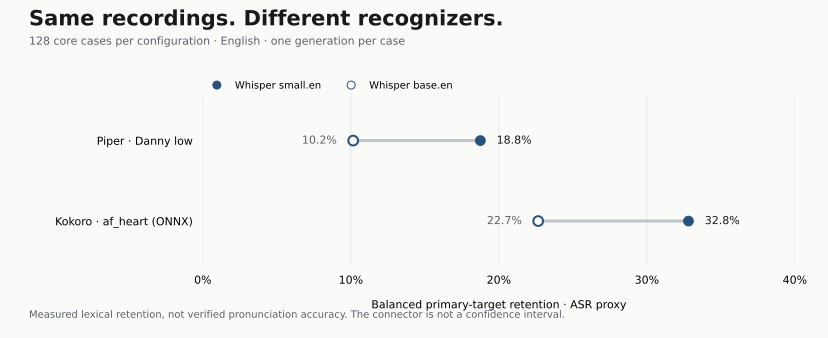

# RareSpeech

### The uncommon word deserves its own measurement.

**Long-tail lexical fidelity for text-to-speech.** A fixed English specialist-word collection, occurrence-level scoring and original audio evidence—designed to report **beside WER**.

[Open the explorer](https://owenawsong.github.io/RareSpeech/) · [Get started](#quickstart) · [Measured evidence](#measured-evidence) · [Technical report](docs/TECHNICAL_REPORT.md) · [Model-card integration](docs/SUBMISSIONS.md)

> **v0.2 · Candidate research toolkit.** Automatic target retention is an **ASR proxy**, not pronunciation accuracy. Expert pronunciation references and independent acoustic calibration remain pending. The software and measured recordings are available now; this is not a validated pronunciation leaderboard.

## When one term carries the sentence

In a thirty-word passage, substituting one specialist term can produce just **3.3% WER**. That term may carry the central information. Whole-passage WER records the error; it does not give that word extra importance.

RareSpeech anchors the target occurrence and reports whether its reference tokens survived transcription. You can then **listen to the original audio**, inspect the alignment and compare recognizers. ASR can also reconstruct an intended spelling from incorrectly pronounced speech, so a retained target still needs acoustic review.

| Question | What you can inspect |
|---|---|
| **Which terms failed?** | Exact target spans, reference/transcript alignment and the source recording. |
| **Does context change the result?** | The same 64 terms bare and in short neutral context; separate repetition, long-context and familiar-control cases. |
| **How much depends on the recognizer?** | Hash-bound ASR configurations, paired target disagreement and measured second-recognizer audits. |
| **Can another researcher check it?** | Frozen tracks, model/audio/evaluator identities, paired comparisons and model-concealed listening packets. |

## Measured evidence

<p><a href="docs/BASELINES.md"></a></p>

**Same recordings. Different recognizers.** The release includes **256 full-core recordings** from Piper / `en_US-danny-low` and Kokoro-82M v1.0 / `af_heart` (ONNX), with both `small.en` and `base.en` transcripts. One generation per case, one voice configuration per architecture. Human review results are empty.

The [baseline appendix](docs/BASELINES.md) contains WER, retention, condition breakdowns, original WAVs, configuration identities and paired comparisons. Another **96 historical integration clips** remain separately available; author-model examples do not define the benchmark.

## A small fixed core. A separate stress track.

| Track | Design | Use |
|---|---|---|
| **Core v1 · 128 cases** | 64 specialist term families × bare / short-context conditions, across eight domains. | A complete, comparable automatic result beside WER. |
| **Stress v1 · 192 cases** | Repeated occurrences, longer passages and documented familiar controls. | Probe failure patterns without mixing controls into the rare-target score. |
| **Legacy v0.1 · 320 cases** | The original collection, preserved under its original protocol. | Reproduce historical experiments. |

**Mineralogy · Botany · Manuscript studies · Linguistics · Zoology · Astronomy · Mathematics · Musicology**

`omphacite` · `anaptyxis` · `opisthograph` · `pterygopodium` · `sesquialtera`

Every occurrence has exact character offsets, a lexical source link and frequency provenance. Zipf zero means below the frequency list's coverage; it does **not** prove absence from model training. Specialist familiarity, shared carrier templates and the small English-only collection limit generalization. Terms still await expert acoustic acceptance rules. [Dataset card →](data/DATASET_CARD.md)

### What the headline means

**Balanced primary-target retention** gives domains, families and conditions equal weight, with repeats nested inside each case. It is separate from whole-passage WER and the historical occurrence score. Familiar controls stay separate.

Missing generations, transcripts and declared repeats cannot silently improve a complete result. Blank transcripts count as failures; mixed recognizer settings block a comparable aggregate. Paired lexical-dependency bootstrap comparisons retain related samples together and withhold unsupported intervals. These intervals do not correct ASR bias. [Full measurement protocol →](docs/METHODOLOGY.md)

## Quickstart

**Inspect the collection and evidence first.** Python 3.10+. Core scoring and report generation have **no third-party runtime dependencies**; canonical datasets and report assets are included in the Python package.

```bash
git clone https://github.com/owenawsong/RareSpeech.git
cd RareSpeech
python -m pip install -e .
rarespeech validate
rarespeech corpus-audit --out audit.json
python scripts/build_site.py
rarespeech serve site
```

Open **http://127.0.0.1:8765**. Explore the cases, inspect measured results and listen locally. Reports use no cloud judge, telemetry or remote fonts.

### 1. Evaluate your pipeline

Use a persistent Python adapter, a shell-free command, a speech API or existing WAVs. Configure an [adapter](examples/README.md), then run:

```bash
python -m pip install -e ".[asr]"
rarespeech benchmark --adapter adapter.json --model-label MyModel --out runs/model
rarespeech serve runs/model/report
```

The default is the **complete core**. `--track stress` selects stress cases; `--track legacy` reproduces the original collection. `--variant isolated --limit 8` is a quick diagnostic subset, explicitly ineligible as a full-track result. ASR downloads its model on first use; TTS dependencies and weights are separate.

Already have audio? Use `rarespeech import-audio`. Already have transcripts? Use hash-bound JSONL and skip recognizer installation. [Complete instructions →](docs/QUICKSTART.md)

### 2. Compare, then listen

```bash
rarespeech compare reports/baseline/report.json reports/candidate/report.json --out comparison.json
rarespeech study --reports reports/baseline/report.json reports/candidate/report.json --out study
rarespeech serve study
```

Comparisons require identical corpora, repeats, evaluator and recognizer configurations. Listening packets preserve original audio hashes while concealing model/source IDs and ASR verdicts; reference text remains visible and voices may be recognizable. Keep the organizer key outside the shared packet. Restore exported decision identities with `rarespeech unblind`.

Human consensus is a **separate measurement**. Distinct pseudonyms, playback records and agreement alone do not prove reviewer expertise or independence. [Listening workflow and rubric →](docs/SUBMISSIONS.md)

### 3. Put an auditable result in your model card

```bash
rarespeech submission --report runs/model/report/report.json --out submissions/model
```

The command produces submission JSON and a Markdown model-card table; generated reports also include an ASR-proxy badge. Submission checks cover frozen-track identity, complete coverage, immutable model revision, recognizer provenance and reconstructed measurements. **Passing software checks is not scientific validation.**

Publish the actual report/audio evidence alongside the score. Label it **“RareSpeech core v1 · balanced target retention (ASR proxy)”** and retain the voice, recognizer and provenance fields. A subset or stress result cannot stand in for the complete core. [Submission requirements →](docs/SUBMISSIONS.md)

## Help make the next empirical step happen

The highest-value contributions are **expert lexical review, human reference recordings and independent proxy calibration**. Independent model reproductions and adapters are also welcome.

- [Technical report](docs/TECHNICAL_REPORT.md): research question, design, score and limitations.
- [Validation plan](docs/RESEARCH_PLAN.md): qualified review and listening-study requirements.
- [Contributing cases](docs/CONTRIBUTING_CASES.md): documented terms and defensible acceptance rules.
- [Contributing code](CONTRIBUTING.md): adapters, tests and report improvements.
- [Release verification](docs/VERIFICATION.md): software and artifact checks, separate from scientific endorsement.

RareSpeech complements evaluation work including [EmergentTTS-Eval](https://github.com/boson-ai/EmergentTTS-Eval-public) and [Open TTS Eval](https://github.com/inworld-ai/open-tts-eval). It does not claim to be the first rare-word or difficult-input benchmark.

## License and citation

Software/interface: [MIT](LICENSE). Original collection, annotations and author-created synthetic examples: [CC BY-SA 4.0](data/LICENSE), including frequency-derived metadata; see [NOTICE](NOTICE) and [audio attribution](examples/README.md#source-and-audio-notices). Optional models and dependencies retain their own licenses. Model weights are not redistributed.

Use [CITATION.cff](CITATION.cff). The technical report is software documentation, not a peer-reviewed paper. Built by [Owen Song](https://github.com/owenawsong), a student developer. The author maintains Inflect; that relationship is disclosed in its historical examples.
