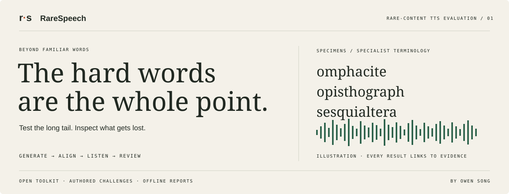
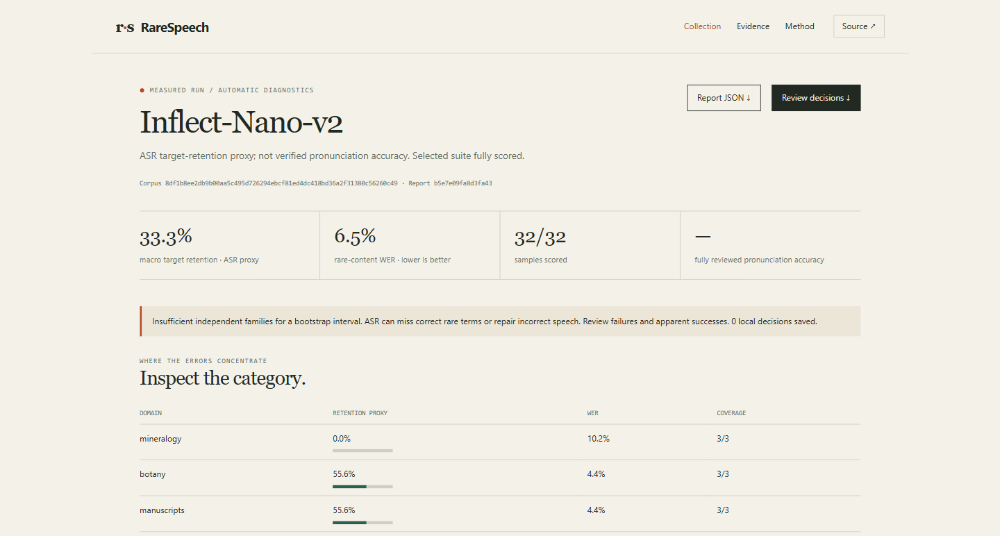

<p align="center"></p>

<p align="center"><strong>Find what text-to-speech loses when the words get unfamiliar.</strong><br>Rare terminology. Dense passages. Repeated entries. Evidence you can hear.</p>

<p align="center"><a href="#try-it">Try it</a> · <a href="docs/QUICKSTART.md">Run your model</a> · <a href="docs/METHODOLOGY.md">Scoring</a> · <a href="data/DATASET_CARD.md">Dataset</a> · <a href="docs/CONTRIBUTING_CASES.md">Contribute</a></p>

---

## A small error can lose the entire point.

Imagine a 30-word sentence whose one specialist term is spoken incorrectly. A transcript might show only **3.3% WER**—or reconstruct the intended word and conceal the pronunciation error altogether.

RareSpeech makes those important occurrences inspectable. Generate or import audio, align transcripts, inspect each target, and open the evidence in an offline report. Listen, record judgments, and compare checkpoints.

**The question:** how faithfully does your TTS pipeline deliver uncommon content?

> **v0.1 status:** working evaluation software with an authored **candidate** collection. Automatic scores are ASR proxies. Expert pronunciation validation is pending. Bundled measured examples are integration pilots, not a human-quality leaderboard.

## What you get

| | |
|---|---|
| **320 cases / 8 domains** | 64 term families, with written-frequency evidence and exact target offsets. |
| **Five conditions** | Isolated, dense, confusable, extended, and familiar-text controls. |
| **Bring your model** | Python adapters, shell-free commands, speech endpoints, or existing WAV folders. |
| **Inspect each occurrence** | Missing, substituted, and repeated content remains visible alongside whole-passage WER. |
| **Hear the evidence** | Audio, waveforms, alignment, category tables, and review queues in an offline report. |
| **Review separately** | Pass/fail/uncertain decisions with audio-bound provenance and consensus coverage. |
| **Compare releases** | Corpus/audio hashes, evaluator versions, checkpoint diffs, and family-bootstrap intervals where supported. |
| **Share the result** | Exportable JSON and a generated model-card Markdown table. |

<p align="center"></p>

<p align="center"><sub>Actual 32-case integration pilot. ASR-derived diagnostics; pronunciation review pending.</sub></p>

### How far into the long tail?

**Mineralogy · Botany · Manuscript studies · Linguistics · Zoology · Astronomy · Mathematics · Musicology**

Explore **omphacite**, **anaptyxis**, **opisthograph**, **pterygopodium**, and **sesquialtera**. Rarity estimates and uncertainty labels travel with the cases. Below a frequency list’s coverage does not mean a word never occurs or was absent from training.

Carrier text is original. Terms are candidate lexemes; dictionary links are discovery aids, not completed expert pronunciation reviews. Read the [dataset card](data/DATASET_CARD.md).

## Try it

Python 3.10+. **No runtime dependencies for the core.** Run from the repository root so the dataset and example integrations are available.

```bash
git clone https://github.com/owenawsong/RareSpeech.git
cd RareSpeech
python -m pip install -e .
rarespeech validate
rarespeech serve site
```

Open **http://127.0.0.1:8765**. Explore the collection and real audio examples. The static site does not run models or upload your data.

### Test your model

Use [an adapter](examples/) or import your audio. For a working local OpenAI-compatible TTS server:

```bash
rarespeech generate --adapter examples/adapter-api.json --model-label MyModel --variant isolated --limit 8 --out runs/my-model
python -m pip install "rarespeech[asr]"
rarespeech transcribe --run runs/my-model --out runs/my-model/asr.jsonl
rarespeech evaluate --run runs/my-model --transcripts runs/my-model/asr.jsonl --out runs/my-model/report.json
rarespeech report runs/my-model/report.json --audio-root runs/my-model --out reports/my-model
rarespeech serve reports/my-model
```

The example endpoint is `http://127.0.0.1:8880/v1/audio/speech`; supply a server or change the adapter. ASR downloads a Whisper model on first use. Model dependencies and compute are separate from the toolkit.

Already have speech? Use `rarespeech import-audio`. Already have transcripts? Supply [hash-bound JSONL](docs/QUICKSTART.md#bring-your-own-transcripts) and skip ASR installation.

```bash
rarespeech compare reports/baseline/report.json reports/candidate/report.json --out changes.json
```

Compare identical selected corpora and repeat IDs with the same ASR setup. Confirm apparent regressions by listening.

## A score with its workings attached

**Automatic target retention** is the category-macro average of aligned target matches. It is not verified pronunciation accuracy or MOS. Whole-passage WER is shown separately.

Missing audio/transcripts stay visible; incomplete runs receive no complete-suite headline. Blank transcripts count as errors. Controls are excluded from the main score and do not establish a causal rarity penalty.

**Human-reviewed accuracy** requires consensus from two distinct raters for every non-control target. Uncertain and conflicting decisions remain unresolved. Reviewer independence and expertise still need to be established by the study organizer.

The browser saves decisions locally and exports JSONL. The CLI checks report identity, audio hash, target ID, and duplicate reviewers before merging them. [Read the protocol →](docs/METHODOLOGY.md)

## Built to be inspected

- No cloud judge, analytics, remote fonts, or required hosted service.
- Commands run as argument arrays without shell expansion.
- API credentials come from environment variables.
- Resume rejects changed run identities; audio hashes invalidate stale transcripts and reviews.
- Bootstrap resampling keeps term families together.
- Reports include original WAVs and machine-readable results.

## Help make the hard cases defensible

Contribute documented rare terms, accepted pronunciations, varied carrier passages, qualified listening reviews, or reproducible failures. Model adapters are welcome too.

Read [CONTRIBUTING.md](CONTRIBUTING.md) and the [case checklist](docs/CONTRIBUTING_CASES.md). Each challenge needs a reason to exist and a clear acceptance rule.

### Related work

[TTSProof](https://github.com/Mormolykos/ttsproof), [tts-bench](https://github.com/5uck1ess/tts-bench), [Open TTS Eval](https://github.com/inworld-ai/open-tts-eval), and [EmergentTTS-Eval](https://github.com/boson-ai/EmergentTTS-Eval-public) already cover important evaluation layers. [Semantically unpredictable sentence research](https://www.isca-archive.org/sioa_1989/hazan89_sioa.html) informs low-predictability carriers. RareSpeech does not claim to be the first stress or rare-word benchmark.

## License & citation

Code/interface: [MIT](LICENSE). Original challenge text/annotations: [CC BY-SA 4.0](data/LICENSE). Dependencies and optional models keep their own licenses. Frequency metadata uses [wordfreq](https://github.com/rspeer/wordfreq); see [NOTICE](NOTICE).

[CITATION.cff](CITATION.cff) provides software citation metadata. This is not a peer-reviewed paper.

Built by [Owen Song](https://github.com/owenawsong), a student developer working on speech models and useful ML software. Inflect is my own model; its examples use the same evaluator and disclose that relationship.
